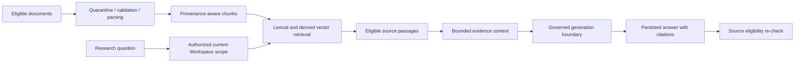

# Research and AI System — Public Overview

**Source:** Public derivative of the private AI System Design (Document 09), AI Capability Roadmap (Document 03), Sprint 006 and the merged Sprint 007 WP4 A+B1 handoff.

## Evidence-oriented pipeline

A generated response is not trusted solely because it includes a citation. Source IDs, version identities and authorized eligibility remain server-side concerns. External model use is subject to the applicable profile, classification, consent and accounting gates.

## Implemented boundary

The research architecture includes reviewed document processing, hybrid retrieval, persisted source-backed answers, and bounded current-Workspace conversation follow-up. The merged tests used synthetic provider transports; actual live model/embedding quality and mandatory Hebrew/English evaluation remain separate acceptance work.

## Deferred or unaccepted capability areas

Research Agent, Workspace Overview, wider document/multi-Workspace generation scope and the broader evaluation/mode work were outside the merged WP4 A+B1 scope. Planned multi-agent and Knowledge Graph systems are not implemented features in this snapshot.

This page intentionally omits exact provider-policy settings, internal prompts, routing rules, rate limits and private evaluation fixtures.
