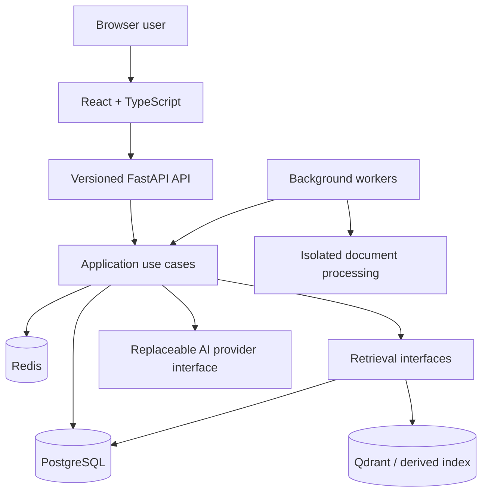

# System Architecture — Public Overview

**Source:** Public derivative of the private System Architecture (Document 06) and implemented repository modules. Sensitive deployment, privileged database and operational contracts are deliberately excluded.

## Architectural stance

CORIPEX uses a **modular monolith**: one logical backend application with independent API and background-processing roles. Module separation serves testing, change isolation and clear ownership; it avoids premature microservice overhead.

## Core engineering boundaries

### Business vs derived state

PostgreSQL is authoritative for identity, document/version and eligibility information. Search indexes and temporary operational state are **derived**, not independent sources of access rights. A retrieved hit alone does not prove that the user may access its source.

### Domain, Application and Infrastructure

Domain types and invariants should not depend on HTTP, database ORM or provider SDKs. Application use cases own workflows and transaction decisions. Infrastructure implements storage, network and background-work interfaces. The directory structure reflects these boundaries.

### Explicit transactions

A Unit of Work owns one application transaction and the trusted authorization context required for protected persistence operations. Repositories operate inside that boundary; they must not commit independently. Read [ADR-007](adr/ADR-007-unit-of-work-repositories-transactions.md).

### Untrusted input and research outputs

Document intake is quarantine-first and passes through bounded validation and isolation. Research output must retain source provenance and re-check source eligibility; the external model is neither an identity authority nor a substitute for the data store.

## What this overview does not provide

It is not a deployable architecture manifest, full trust-zone diagram, privileged SQL schema, secret-management design or threat-model disclosure. There is no guarantee of production deployment or completed live model evaluation.

## Detailed public diagrams

Browse [system context](architecture/system-context.md), [module/UoW boundaries](architecture/module-boundaries.md), [document lifecycle](architecture/document-lifecycle.md), [research flow](architecture/research-flow.md) and [review lifecycle](architecture/engineering-workflow.md). These do not represent a deployable configuration.
