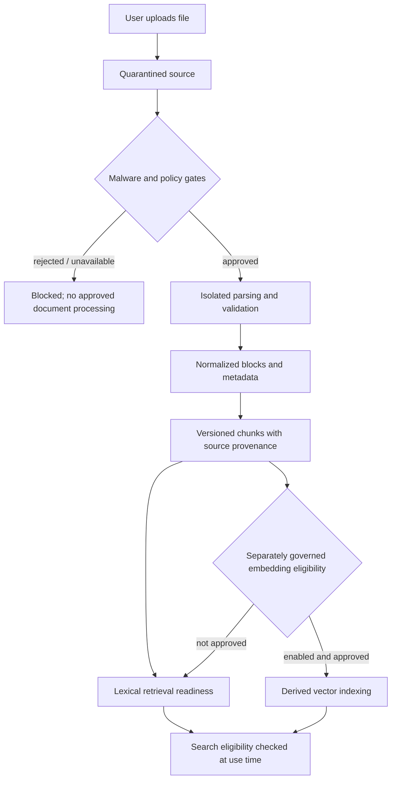

# Secure Document Processing — Conceptual Lifecycle

This is a concept illustration. It does **not** reveal the scanner's exact filters, parser confinement configuration, version activation SQL, security-role implementation or cloud operation. Not every file reaches the approved path. See [the provenance case study](../case-studies/provenance-and-grounded-rag.md).
