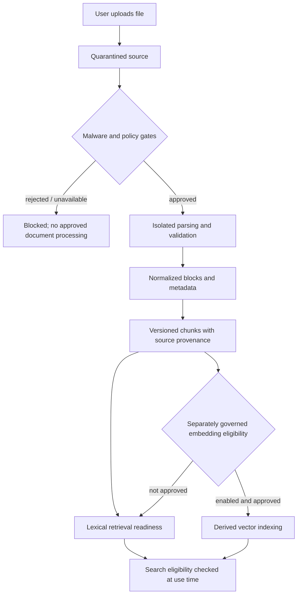

# Secure Document Processing — Conceptual Lifecycle

This is a concept illustration. It does **not** reveal the scanner's exact filters, parser confinement configuration, version activation SQL, security-role implementation or cloud operation. Not every file reaches the approved path. See [the provenance case study](../case-studies/provenance-and-grounded-rag.md).

## Reading the diagram

Files remain untrusted until the admission checks succeed. Rejected files and unavailable scanning stop the approved processing path. Successful local processing produces normalized, versioned data with source provenance.

### Design rationale

- **Admission before intelligence:** document parsing cannot skip the quarantine and scan boundary.
- **Provenance over convenience:** normalized chunks remain connected to their source version and document structure.
- **Independent embedding approval:** lexical readiness can exist even when vector indexing is not approved or available.
- **Read-time eligibility:** retained chunks and indexes cannot independently grant source visibility.

This is an architecture overview, not an operational guide to scanner configuration or parser confinement. Not every file reaches approval. See the [provenance case study](../case-studies/provenance-and-grounded-rag.md).
