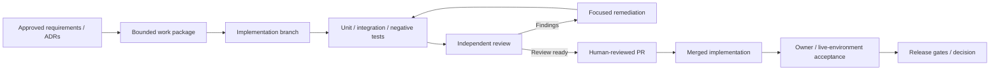

# Engineering Workflow — Evidence Before Acceptance

CORIPEX uses scoped work packages, both human and AI code writing and review, test evidence and explicit acceptance boundaries. The diagram describes the normal method, not an automated approval flow.

For an immutable, commit-scoped quantitative example of this process, read the [engineering quality metrics](../quality-metrics.md).

## Reading the lifecycle

Approved requirements and ADRs scope a Work Package. Implementation and tests generate evidence; independent review findings may return work for focused remediation. A merged pull request is **not** automatically an owner acceptance or a product release.

### What counts as evidence

- Unit/integration tests support the behavior tested on a particular commit.
- Security-sensitive functionality requires its applicable negative and enforcement checks.
- Installed-environment, external-provider and cloud release acceptance have additional human and operational gates.

This makes deferred work explicit instead of equating code merge with full delivery. The [WP3 reconstruction case study](../case-studies/rls-planner-reconstruction.md) illustrates design revision based on evidence.
