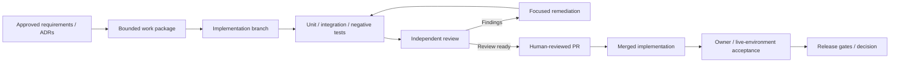

# Engineering Workflow — Evidence Before Acceptance

CORIPEX uses scoped work packages, human review, test evidence and explicit acceptance boundaries. The diagram describes the normal method, not an automated approval flow.

A passing workflow is **not** a declaration that cloud delivery, real AI costs or quality, or full Academic release is accepted. The [RLS case study](../case-studies/rls-planner-reconstruction.md) illustrates review-driven reconstruction.

For an immutable, commit-scoped quantitative example of this process, read the [engineering quality metrics](../quality-metrics.md).
