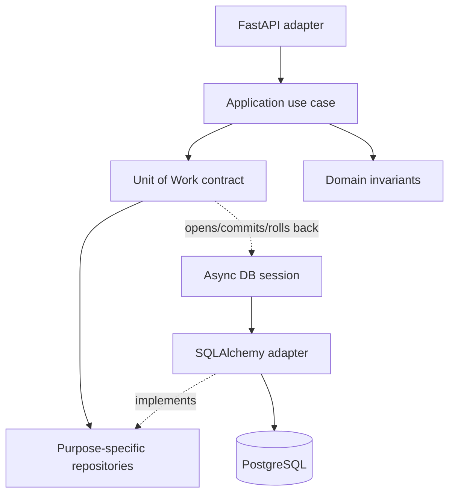
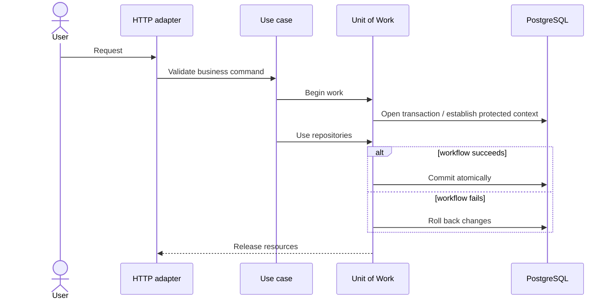

# Modular Architecture and Transaction Ownership

The structure is organized around business capabilities: `documents`, `workspaces`, `search`, `rag`, `identity`, `processing`. Inside a module, application use cases depend on inward contracts; the HTTP and SQLAlchemy adapters implement those contracts. The **Unit of Work** owns transaction lifecycle, not each repository method.

The sequence is a **conceptual simplification**. Do not substitute the [educational UoW sample](../../backend/app/shared/application/uow_demo.py) for the private implementation. Read [ADR-007](../adr/ADR-007-unit-of-work-repositories-transactions.md).
