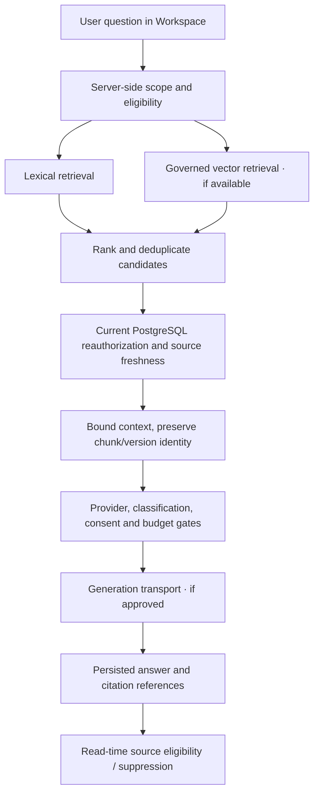

# Source-Grounded Research — Conceptual Data Flow

The diagrams separate **source eligibility** from **relevance**; vector hits are never an authorization authority. The [original rank-fusion function](../../backend/app/search/domain/models.py) provides one real algorithmic example. The [adapted context builder](../../backend/app/rag/application/evidence_demo.py) intentionally omits policy and authorization implementation.

Merged A+B1 integration and synthetic-provider tests do not constitute live-provider or Hebrew/English quality acceptance.
