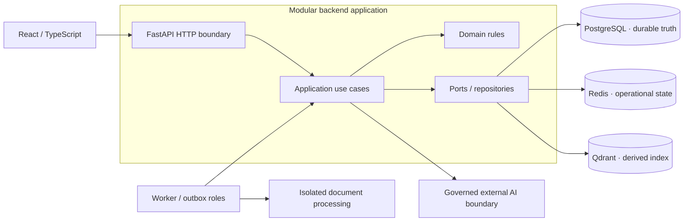

# Component Context — Public Architectural View

The private implementation is a **modular monolith** with separate API/background runtime roles. PostgreSQL is the authority for durable domain and eligibility information. Redis and Qdrant are supporting systems; their contents cannot grant access by themselves.

The presence of a provider boundary does **not** establish successful live AI activation or accepted evaluation. Cloud deployment is still outside the verified release state.

## Reading the diagram

The browser communicates with a single HTTP boundary, while application use cases and domain rules sit within the modular backend. Workers and the outbox are **separate execution roles**, not independently deployed business microservices.

### Why this architecture

- **Modular monolith first:** one backend codebase reduces coordination and deployment overhead while maintaining meaningful module boundaries.
- **Authoritative and derived systems differ:** PostgreSQL owns durable domain and eligibility data; Redis supports operational work, and Qdrant indexes approved source generations.
- **Provider boundary:** external AI integration is replaceable rather than embedded in domain rules.

### Trade-offs and limitations

The architecture favors a simpler operational footprint over independent deployment of every business domain. The diagram deliberately omits precise authentication, networking, secrets and authorization implementation. See the [modular-monolith ADR](../adr/ADR-001-modular-monolith-first.md).
