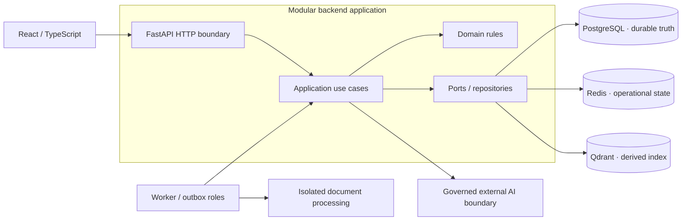

# Component Context — Public Architectural View

The private implementation is a **modular monolith** with separate API/background runtime roles. PostgreSQL is the authority for durable domain and eligibility information. Redis and Qdrant are supporting systems; their contents cannot grant access by themselves.

The presence of a provider boundary does **not** establish successful live AI activation or accepted evaluation. Cloud deployment is still outside the verified release state.
