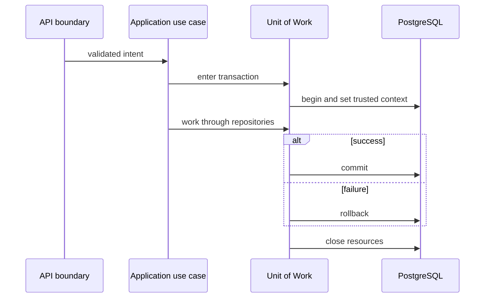

# Case Study — Explicit Unit of Work and Repository Boundaries

**Foundation:** Sprint 002 and ADR-006/ADR-007.

## Design pressure

CORIPEX application workflows must often persist multiple connected changes or reject them together. Repositories that commit independently would create partial state and make protected PostgreSQL context difficult to reason about.

## Decision

A use case coordinates business intent; the **Unit of Work** owns the transaction and exposes purpose-specific repository implementations. Repositories can flush for identifiers/constraints but do **not** commit. The transaction commits only after the workflow succeeds; an exception rolls back the entire unit of work.

## Alternatives rejected

Direct ORM sessions inside HTTP routes, independent repository commits, process-global sessions and one transaction per repository operation were rejected to preserve atomicity, determinism and clear ownership.

## Testing principle

Persistence behavior is reviewed against real PostgreSQL; SQLite is not considered interchangeable when testing transaction-local context, RLS or PostgreSQL-specific constraints.

A tiny pure-domain source example in this repository demonstrates separation of value-object logic from infrastructure, but is **not** a copy of the full Unit of Work implementation.

## Reading the code

The [transaction-boundary demonstration](../../backend/app/shared/application/uow_demo.py) is newly adapted from the UoW architectural decision; it **is not** the private SQLAlchemy/RLS implementation. Its [public tests](../../tests/test_public_samples.py) show ordinary commit and failure rollback, not PostgreSQL integration security evidence.
